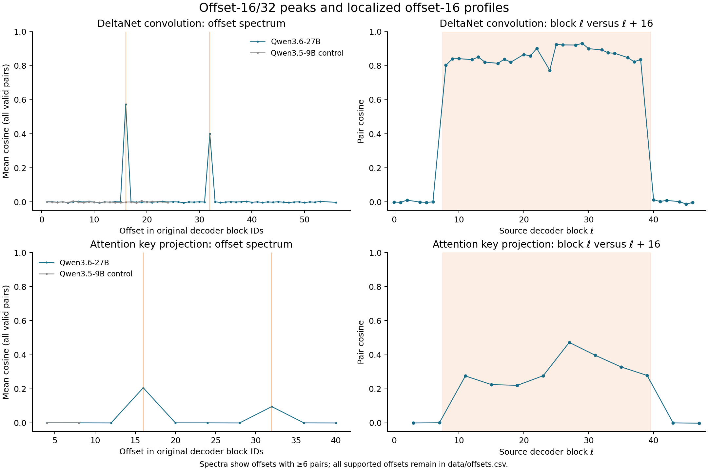

# Repeated block ancestry as a control for Qwen3.6-27B interpretability studies

Jeffrey Shorthill · 2026-10-14 · architecture evidence v0.1.1

## Finding

The weights of Qwen3.6-27B contain a sharp, block-localized similarity pattern consistent
with three trained copies of a 16-block region. In zero-based decoder coordinates,
the corresponding regions are **8–23, 24–39, and 40–55**, with eight blocks below and
eight above. Offsets 16 and 32 connect corresponding positions between these regions.

The evidence is not just a consequence of the model's repeating attention types:
the large similarities are localized to the proposed repeated region, fall sharply at
its boundaries, and are absent at other same-type offsets. Both the DeltaNet convolution
and the full-attention key-projection families carry the offset-16/32 pattern.

## Evidence and controls

The release scans public BF16 tensors at pinned Hub commits, without running the models.
For each tensor family it compares flattened weights between every pair of decoder
blocks carrying that tensor. Means at each offset use all valid pairs; means restricted
to the proposed repeated region are separate estimands. Exact values, counts, and
strongest offsets are generated in [RESULTS.md](RESULTS.md).

The primary model is Qwen/Qwen3.6-27B. Qwen/Qwen3.5-9B supplies a negative control using
the same parameter families. SOLAR-10.7B-v1.0 supplies a positive control with a
[published depth-upscaling construction](https://arxiv.org/abs/2312.15166): the scan
recovers its offset-16 correspondence between blocks 8–23 and 24–39.

The Qwen pattern is strong evidence of shared block ancestry. Cosine similarity does
not reveal the exact historical initialization, amount of continued training, or whether
one region can replace another during inference. The proposed boundaries were identified
in earlier exploratory work; this release is a corrected, pinned reproduction rather
than an independent prospective discovery or a statistical test of a newly registered hypothesis.

## Relevance to J++ Lens

[J++ Lens: Jacobian Filtering Enables More Faithful Workspace Lenses](https://www.lesswrong.com/posts/nc9dHfcB22JdMzGbr/j-lens-jacobian-filtering-enables-more-faithful-workspace)
uses Qwen3.6-27B as its main model. Its readout grid 8, 16, 24, 32, 40, 48, 56 samples
two recurring positions in the inferred regions: 8/24/40 have relative slot 0,
16/32/48 have relative slot 8, and 56 is above the repeated region.

Its Appendix A intervention bands also have a useful ancestry-relative description:

| Band in the write-up | Position under the inferred block mapping |
|---|---|
| 16–28 | Slots 8–15 of the first region, then slots 0–4 of the second |
| 24–35 | Slots 0–11 of the second region |
| 48–59 | Slots 8–15 of the third region, then four blocks above it |

These are mappings of the write-up's stated inclusive bands to zero-based block IDs,
not a new execution of the intervention harness. The released lens code records outputs
of indexed blocks (`record_block_outputs`); any rerun should verify the intervention
hook sites and endpoint conventions against its pinned code too.

The structural finding motivates comparing **corresponding within-region positions**
alongside conventional early/late bands. Depth and ancestry-relative position should both
be retained: the copies have trained apart, occupy different depths, and receive
different inputs. The finding alone neither explains J++'s performance improvement
nor changes the paper's cross-model evidence.

## Next experiment

Use the authors' task and scoring definitions to compare readouts at corresponding
positions across the three regions. For interventions, compare matched slot windows
in each region and jointly across regions. Match or measure perturbation magnitude,
use non-aligned same-type windows and unrelated-concept controls, and measure target
log probabilities and task accuracy. A stronger joint effect alone would not identify
compensation because joint interventions alter more blocks.

A matched-budget J-lens and confirmed expert-weight fitting/evaluation split would
permit a controlled lens comparison. Existing local results use different released
artifacts and a 4-bit forward pass; [the follow-up note](docs/JPP_FOLLOWUP.md) states
their scope. They are not required to reproduce this architecture result.

## Provenance

Earlier exploratory scans and research notes identified the region in September 2026.
The October 14 release repairs model-depth labeling, full-depth offset enumeration,
empty-pair handling, and auxiliary-head selection, with regression tests for those
failure modes. [CORRECTIONS.md](CORRECTIONS.md) records the changes. Checkpoint metadata,
raw tensor hashes, source byte ranges, all layer-pair similarities, and the scanner hash
are included so the result can be inspected independently of the author's working drive.
