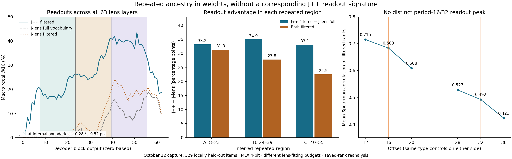

# Repeated block ancestry in Qwen3.6-27B, without a corresponding J++ readout signature

Jeffrey Shorthill · 2026-10-14 · weights and saved-readout evidence v0.2.0

## Main finding

Qwen3.6-27B contains a sharp weight-similarity pattern consistent with three trained
copies of a 16-block region: **8–23 ≈ 24–39 ≈ 40–55**, in zero-based decoder indices.
Our October 12 check of the released J++ lens found **no comparably distinct copy-aligned
signature in its readouts**: its recall advantage persisted across all three regions,
the internal copy boundaries produced small changes, and offset 16 was not a local
peak relative to same-type offsets 12 and 20. The ancestry is visible in the weights;
the readout evidence so far gives no indication that crossing the region boundaries
explains the observed J++ advantage. Matched-slot interventions remain the open test.

## Weight evidence and calibration

Offsets 16 and 32 connect corresponding positions in the three inferred repeated
regions, with eight blocks below and eight above. The pattern is localized to that
region and falls sharply at its boundaries. Both the DeltaNet depthwise-convolution
and full-attention key-projection families carry it. These tensors differ greatly in
size and structure: **40,960 parameters per Qwen3.6-27B conv1d kernel versus 5,242,880
per key projection**. Their raw cosine magnitudes are reported separately; comparisons
use the same parameter family across models rather than ranking the two families.

| Parameter family | Qwen3.6-27B offset 16 / 32 | Qwen3.5-9B offset 16 | SOLAR offset 16 |
|---|---:|---:|---:|
| DeltaNet conv1d | .573 / .400 (36 / 24 pairs) | −.000381 (12 pairs) | Not applicable |
| Attention key projection | .206 / .096 (12 / 8 pairs) | .000060 (4 pairs) | .435 (32 pairs) |

These are means over all valid pairs. [RESULTS.md](RESULTS.md) separates means restricted
to the inferred copied region. Tensor sizes also differ across checkpoints; the controls
calibrate each parameter family, not an exact cross-model equivalence of training history.

SOLAR supplies a quantitative yardstick with a
[documented duplication followed by continued pretraining](https://arxiv.org/html/2312.15166v3):
its key-projection mean at offset 16 is **.435 overall and .871 within the copied region**,
versus **.206 and .309 in Qwen's key projections**. Qwen3.5-9B supplies the same-family
negative controls in the table. SOLAR has no DeltaNet convolution counterpart.

Within the inferred Qwen copied regions, similarity decreases with separation:
offset-16 versus offset-32 means are **.858 versus .800 for conv1d**, and **.309 versus
.191 for key projections**. Offset 32 compares the first and third regions, two block
periods apart. This is consistent with shared-copy ancestry followed by
position-dependent training divergence. It does not establish two sequential
copying/training stages or exclude simultaneous initialization from one source.

## October 12 readout result: the advantage persists across copies

We scored the released J++ lens, Neuronpedia J-lens, and logit lens at **all 63 available
lens layers (0–62)** on a locally reconstructed held-out split of **329 items / 526
item–intermediate units** across five tasks. For each region, recall@10 uses the best
rank within that region, averages intermediate hits within items, then macro-averages
the tasks. Under the paper's reporting convention (filtered J++ versus full-vocabulary
J-lens), the observed advantage is approximately **+33, +35, and +33 percentage points**.

| Inferred region | J++ recall@10 | J-lens recall@10 | Approximate gain |
|---|---:|---:|---:|
| A: 8–23 | 36.5% | 3.3% | +33 pp |
| B: 24–39 | 49.0% | 14.0% | +35 pp |
| C: 40–55 | 60.4% | 27.4% | +33 pp |

J++'s per-layer recall changes by **−0.28 pp at 23→24** and **−0.52 pp at 39→40**.
Its filtered-rank similarity at offsets **12 / 16 / 20 is .715 / .683 / .608**; offset
16 lies on a smooth decline, not a distinct local peak. The corresponding offset-32
comparison is .527 / .492 / .423 at offsets 28 / 32 / 36. The small positive excesses
over the mean of neighboring offsets (.022 and .017) are not a weight-like peak.

This is a measured negative result on the authors' released instrument: the strong
ancestry signal in weights is not mirrored by a distinct periodic readout signature
in this capture, and the observed advantage is not confined to a particular copy.
It does not prove statistical equivalence between regions or establish zero bias in
the authors' BF16 results. With both readouts filtered, gains remain positive but vary
more across regions: **+31.3 / +27.8 / +22.5 pp**. Forward activations were MLX 4-bit;
the J++ and Neuronpedia J-lens artifacts were fitted on 64 versus 1000 prompts, and
the released J++ fitting/evaluation split is unconfirmed. Those differences qualify
the performance comparison without erasing the observed readout null.

The [rank table and provenance](data/jpp_readouts/README.md) are public. Run
`python scripts/reanalyze_readouts.py` to reproduce region scores, per-layer curves,
boundary deltas, and offset controls from the saved ranks. This is reanalysis of the
October 12 experiment, not a new model run or a matched-budget lens replication.

## Why this matters for J++ interventions

[J++ Lens](https://www.lesswrong.com/posts/nc9dHfcB22JdMzGbr/j-lens-jacobian-filtering-enables-more-faithful-workspace)
uses Qwen3.6-27B as its main model. Its grid samples recurring slots: 8/24/40 are slot
0, 16/32/48 are slot 8, and 56 is above the repeated region. Its Appendix A bands map
to different portions of those regions:

| Published band | Verified source | Position under the inferred mapping |
|---|---|---|
| 16–28 | Figure 6 caption | Slots 8–15 of A, then slots 0–4 of B |
| 24–35 | Figure 7 accompanying text | Slots 0–11 of B |
| 48–59 | Figure 7 accompanying text | Slots 8–15 of C, then four blocks above it |

The [source check](docs/SOURCE_CHECKS.md) verifies the published ranges. The table
treats endpoints as inclusive; execution and hook conventions must be verified in a
new intervention run. The lens code records outputs of indexed blocks.

The readout result reduces the immediate concern that repeated ancestry creates the
apparent readout gain. The unresolved question is causal use: compare corresponding
slot windows in A, B, and C, individually and jointly, on the original task. Include
non-aligned same-type windows, unrelated-concept controls, and matched/measured
perturbation magnitude; measure target log probabilities and task accuracy. A joint
effect alone does not identify compensation because more blocks are perturbed.

## Provenance

Earlier September scans identified the region; the corrected October 14 BF16 weight
scan pins checkpoint commits, tensor hashes and byte ranges, with SOLAR and Qwen3.5-9B
controls. The October 12 readout capture is separately identified by source-file,
lens, tokenizer, evaluation-file, and quantized-model configuration hashes. The release
reproduces weight measurements online and readout statistics from saved ranks; it does
not redistribute models, lenses, activations, or unrelated exploratory conversations.
See [METHODS.md](METHODS.md), [CORRECTIONS.md](CORRECTIONS.md), and
[the readout follow-up](docs/JPP_FOLLOWUP.md).
