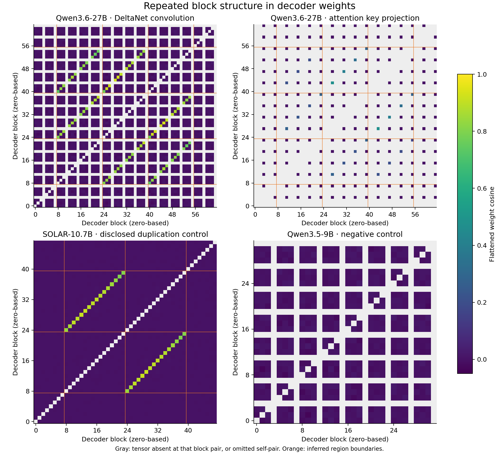

# Repeated block structure in Qwen3.6-27B

**Qwen3.6-27B has a localized repeated-block weight pattern at offsets 16 and 32,
consistent with three trained copies of a 16-block region: 8–23 ≈ 24–39 ≈ 40–55.**
The pattern is present in both DeltaNet convolution and full-attention key-projection
weights. This release packages decoder-only measurements, a disclosed-duplication
positive control, a smaller-model negative control, figures, and CPU reproduction code.

Jeffrey Shorthill · independent interpretability research · 2026-10-14 · v0.1.2



## Read the evidence

- **[Research note](NOTE.md):** finding, evidence, and relevance to J++ Lens.
- **[Numerical results](RESULTS.md):** generated tables, including pair counts and region means.
- **[Methods](METHODS.md):** tensor selection, cosine definition, controls, and indexing.
- **[Correction record](CORRECTIONS.md):** layer counts, offset enumeration, auxiliary-head exclusion, and claim wording.
- **[Data dictionary](data/README.md):** CSV/JSON schemas and provenance.
- **[J++ follow-up](docs/JPP_FOLLOWUP.md):** preliminary readout comparison and the specific next experiment.

All block indices are zero-based original decoder indices. Qwen3.6-27B has **64 decoder
blocks: 48 DeltaNet and 16 full-attention**. Auxiliary multi-token-prediction parameters
are excluded. Tensor-bearing block counts are not model depth.

## Reproduce

Python 3.11 or newer; CPU only. No model execution and no full model download.

```bash
python3 -m venv .venv
source .venv/bin/activate
python -m pip install -r requirements.txt

# Offline: check the distributed evidence and regenerate the plots/tables.
python -m unittest discover -s tests -v
python scripts/verify_release.py
python scripts/make_report.py --out /tmp/qwen-block-figures --report /tmp/qwen-block-results.md

# Online: independently range-read selected public tensors at pinned Hub revisions.
# Keep the released evidence intact by writing a new capture directory.
python scripts/scan_weights.py --out reproduction/data --provenance reproduction/metadata
python scripts/make_report.py --data reproduction/data --out reproduction/figures --report reproduction/RESULTS.md
```

GitHub: https://github.com/ec75hash/qwen-depth-upscaling-jpp-check  
Hugging Face: https://huggingface.co/datasets/ec75hash/qwen-depth-upscaling-jpp-check

The online scan downloads selected tensor byte ranges and shard headers, not complete
weight shards. It checks HTTP range responses before accepting data. Temporary tensor
bytes are cached under `.cache/tensors/` and are not part of the release. Public
downloads do not require an access token. Network time varies; see the recorded runtime
and tensor byte totals in `data/provenance.json`.

`models.lock.json` pins checkpoint commits and metadata hashes. Each selected tensor
has a SHA-256, source shard, dtype, shape, and byte range in `data/provenance.json`.
`checksums.json` covers released evidence and analysis code.

An optional GitHub Actions workflow is provided at `docs/verify-workflow.yml`. Move it
to `.github/workflows/verify.yml` when publishing with credentials that permit workflow
installation. This release's verification was executed locally from a clean checkout.

## What this establishes

The measurements identify block-localized weight similarity across two parameter
families and recover the known duplicated region in SOLAR-10.7B. They support a shared
block-ancestry interpretation for Qwen3.6-27B. The exact unpublished construction recipe
is inferred; functional interchangeability and compensation between copies are open.

The finding is relevant to interpreting layer comparisons in
[J++ Lens (Ayonrinde and Lindsey, 2026)](https://www.lesswrong.com/posts/nc9dHfcB22JdMzGbr/j-lens-jacobian-filtering-enables-more-faithful-workspace),
which uses Qwen3.6-27B as its main model. Corresponding block positions provide a
structural control alongside absolute depth. This release does not claim a matched
reproduction of the paper's lens-performance comparison or a causal explanation of its gains.

## Scope and attribution

This is a focused architecture-evidence release. It contains derived similarities and
small upstream metadata files; it contains no model weights, lens weights, private
correspondence, or model-generated conversation transcripts. The broader MoE routing
and availability studies are separate work.

Research questions, original investigation, and interpretation: Jeffrey Shorthill.
Codex assisted with this release's scanner, regression checks, analysis, figures, and
documentation. Claude/Codex assistance in earlier work is recorded in the research
history; this package does not claim all instrumentation was handwritten by the author.

Code: Apache-2.0, see [LICENSE](LICENSE). Original derived tables, figures, and prose:
CC BY 4.0, see [LICENSE-DATA.md](LICENSE-DATA.md). Upstream metadata retain their original
licenses and attribution; see [NOTICE](NOTICE). A machine-readable citation is in
[CITATION.cff](CITATION.cff).
